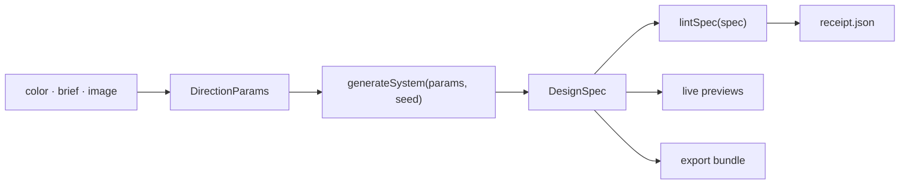

# 🎨 `dyelot`

> 🧾 **A palette becomes a design system your coding agent can build.**
> M0 and M1 are done: the shell, and a tested color engine and spec model. The studio and the export bundle come next.

📖 [Why](WHY.md) · 📐 [Design spec](docs/specs/00-design.md) · 🧮 [Engine spec](docs/specs/01-color-engine.md) · 🏗️ [Architecture](docs/specs/00-design.md#3-architecture) · 🗺️ [Milestones](docs/specs/00-design.md#14-milestones)


---

```console
$ pnpm install
$ pnpm dev                                    # http://localhost:3000: the shell and a status page
$ pnpm lint && pnpm typecheck && pnpm test    # the quick gates
$ pnpm test:e2e                               # builds, serves on port 3100, drives Chromium
```

---

## 💡 Why this exists

A palette is a few swatches. A product needs roles, a light mode and a dark mode, and a measured
contrast for every pair of text and background. Palette tools stop at the swatches, the nearest theme
editor serves one framework, and the DESIGN.md catalogs copy real brands. dyelot aims to take a color,
a few words or an image to a complete system that a coding agent can build from. [WHY.md](WHY.md) has
the full reasoning.

---

## 🎯 What it will do

The goal comes from the [design spec](docs/specs/00-design.md). There is no studio yet, so none of this reaches a
visitor today. M1 built the engine underneath the second and fifth bullets. The next section says what it does.

- 🎨 **Start from anything** — a color, a few words, an image, a curated system or an existing DESIGN.md
- 🧮 **Computed, accessible systems** — color roles and scales for light and dark mode, plus type, space, shape, depth and motion, solved for WCAG 2.2 contrast
- 👀 **Live previews** — six realistic pages that share one state, at phone, tablet and desktop widths
- 📦 **Agent handoff** — one download with DESIGN.md, an AGENTS.md block, `theme.css`, DTCG tokens, a shadcn install file and a ready prompt
- 🧾 **A receipt for every color** — `receipt.json` records measured contrast, color-blind distinguishability and gamut membership
- 🎬 **Flavor** — a palette-driven animated background, a brand video rendered in the browser and motion tokens

---

## 🧮 The engine today (M1)

A pure TypeScript core in `src/engine/` and `src/spec/`, with no DOM, no network and no `Math.random`. It has no UI
yet: you reach it through its functions and its tests. The [engine spec](docs/specs/01-color-engine.md) has every
rule and case.

- 🎨 **Color math** — parses hex, `rgb()` and `oklch()`, converts between OKLCH, sRGB and Display P3, and maps to a gamut with the CSS Color 4 method
- 📏 **Contrast-solved scales** — 11 steps per palette, each solved for a WCAG 2.2 contrast target and measured again on the 8-bit hex it emits, in light and dark mode
- 🧩 **A complete color system** — eight palettes, 46 roles per mode, chart colors picked to stay apart under three kinds of color blindness, and a locked brand color kept verbatim where contrast allows
- 🔤 **Non-color tokens** — type scales by context, space, radius, shadows and motion
- 🧾 **A spec with an identity** — the `dyelot.spec/1` schema, a canonical form, a 16-hex spec id and a share link with an integrity check that rejects any one-character change
- 🔍 **A linter** — 20 measured rules over contrast, color-blind distinguishability, scale order, chroma, gamut and dark mode

---

## 🔧 Architecture

The planned layers and their rules are in the [design spec](docs/specs/00-design.md#3-architecture).
The shell and the pure core exist today: `generateSystem` and `lintSpec` in the diagram below. The previews, the
receipt and the export bundle come in later milestones.



---

## 🗂️ Project structure

```text
src/
├── app/                    routes, metadata files and the error boundaries
├── components/terminal/    the house shell: nav, window, prompt, status bar
├── engine/                 the pure core: generateSystem and the linter
│   ├── color/              parsing, conversion, gamut, contrast, scales, palettes, roles, charts
│   ├── tokens/             type, space, shape, depth and motion
│   └── lint/               the 20 color rules
├── spec/                   the dyelot.spec/1 schema, canonical form, spec id and share-link codec
└── lib/
    ├── site/               the validated site config and the metadata modules
    └── links.ts            the repository address
tests/
├── unit/                   Vitest, with engine and spec tests in plain Node
└── e2e/                    Playwright
docs/specs/
├── 00-design.md            the design spec (the umbrella)
└── 01-color-engine.md      the M1 spec: the engine, the spec model and the linter
scripts/render-icons.mjs    renders the raster icons from src/app/icon.svg
```

---

## 🚀 Usage

You need pnpm 10 and a Node version that jsdom 30 supports: 22.22.2 or later on 22, 24.15.0 or
later on 24, or 26 and up. CI runs Node 24.

```bash
pnpm install
pnpm dev          # http://localhost:3000
```

`pnpm dev` serves on port 3000. The end-to-end run builds the app and serves that build on port 3100
(set `PORT` to change it), so a dev server and a test run can share a machine.

| Command | What it does |
|---|---|
| `pnpm dev` | Dev server on port 3000 |
| `pnpm build` · `pnpm start` | Production build, then the production server on port 3000 |
| `pnpm lint` · `pnpm format` | Biome check, and Biome check with fixes applied |
| `pnpm typecheck` | `next typegen && tsc --noEmit` |
| `pnpm test` · `pnpm test:watch` | Vitest once, and in watch mode |
| `pnpm vitest run --coverage` | Unit tests with the coverage floors enforced |
| `pnpm test:e2e` | Builds, serves on port 3100 and runs Playwright on Chromium |
| `node scripts/render-icons.mjs` | Renders `favicon.ico`, `apple-icon.png` and the three manifest PNGs from `src/app/icon.svg` with Playwright's Chromium |

Run `pnpm exec playwright install chromium` once before the end-to-end tests or the icon script. Pass a
directory to the icon script to write the files there instead of in place.

`.env.example` documents `NEXT_PUBLIC_SITE_URL`. The app runs without it.

---

## 🧱 Stack

| Concern | Choice |
|---|---|
| App | Next.js 16.4 App Router, React 19.3, TypeScript strict |
| Style | Tailwind 4.3, the portfolio's dark terminal tokens, Geist and Geist Mono, one madder accent |
| Color | OKLCH and WCAG 2.2 contrast, in a pure TypeScript engine |
| Spec | zod 4 in jitless mode (no `eval` under the CSP), fflate for the share link |
| Quality | Biome, Vitest with jsdom, fast-check, Playwright with axe |
| Tooling | pnpm 10, Node `^22.22.2 \|\| ^24.15.0 \|\| >=26` (CI runs 24) |
| CI | GitHub Actions: lint, typecheck, unit tests with coverage and the build, then Playwright on Chromium |

---

## 🧪 Testing

| Metric | Value |
|---|---|
| Unit | 738 Vitest tests in 46 files, in `tests/unit/`. Engine and spec tests run in plain Node. The rest run in jsdom with Testing Library. An exhaustive sweep of all 16,777,216 8-bit seeds runs only with `DYELOT_EXHAUSTIVE=1` |
| Spec cases | Every case in [`01-color-engine.md`](docs/specs/01-color-engine.md) has a test that carries its id, such as `C-SCALE-02`: 344 of 344 at the M1 close |
| Property tests | fast-check over arbitrary color strings, every parameter, random seeds and share-link tampering |
| End to end | Playwright on Chromium against `next build` and `next start`, with axe accessibility checks on the home and 404 pages and checks on the security headers |
| Coverage scope | `src/engine/`, `src/spec/` and `src/lib/site/`, the pure modules. The end-to-end tier covers the components and routes |
| Coverage floors | 80% lines and statements, 75% functions and 70% branches over that scope. `src/engine/` and `src/spec/` hold 95% lines, statements and functions and 90% branches |
| Coverage at the M1 close | 100% statements, functions and lines, 99.85% branches, over that scope. `src/engine/` and `src/spec/` are at 100% on all four |
| Static checks | Biome, and `tsc` in strict mode |

```bash
pnpm test                        # unit
pnpm vitest run --coverage       # unit, with the floors
pnpm test:e2e                    # builds, serves and drives Chromium
```

---

## 🏛️ Engineering philosophy

| Principle | How it shows up |
|---|---|
| 🔴 **Spec-TDD** | `docs/specs/01-color-engine.md` lists every case, pass and failure, before the code. Every spec case has a test that carries its id. Tests come first. |
| 🚫 **Negative-space programming** | Public functions check their input, and the spec's failure cases test the checks. A wrong type throws `TypeError` and a value outside its domain `RangeError`. Color parsing, scale solving and link decoding have their own error types. A property over random parameters finds no NaN or Infinity in a generated spec. One internal kernel, the 3 by 3 matrix product, checks nothing. Its callers check first, and its comment says so. |
| 🔒 **Typed everything** | TypeScript strict with no `any`. A `Hex` is a branded string. In the core only `toHex` and the schema make one, and a guard test fails on any other cast. The schema is where a decoded link becomes a typed spec. |
| 🧊 **Pure core, imperative shell** | `src/engine/` and `src/spec/` use no DOM, no Node API, no `Date` and no `Math.random`. A grep test enforces it, and their tests run in plain Node, where a DOM call fails. Randomness comes only from a seeded generator. The same seed gives the same spec on every run in Node, and a golden spec id pins it. Browsers are not measured yet: the engine uses `Math.cbrt`, `Math.exp` and other functions whose last bits ECMAScript leaves to each engine. |
| 🧾 **Measure what ships** | Contrast is measured on the 8-bit hex the engine emits, never rounded, so a ratio of 4.499 fails 4.5. |
| 📦 **One responsibility per module** | Parsing, conversion, gamut, contrast, scales, palettes, roles, charts, tokens, the schema, the canonical form, the hash and the link codec each have their own file. |

---

## 🚫 Scope

Version 1 has no accounts, no server-side storage of designs, no paid tier, no brand-clone presets and
no server-side video rendering. Section 15 of the [design spec](docs/specs/00-design.md) lists the
rest.

---

## 🚧 Status

- **M0, done.** The repo in the house skeleton: Next 16.4, Biome, Vitest, Playwright, CI, site
  metadata, security headers, the terminal shell and the design spec.
- **M1, done.** The color engine, the spec model and the linter, in `src/engine/` and `src/spec/`,
  built to the [engine spec](docs/specs/01-color-engine.md). It has no UI yet.
- **Next.** M2 the studio and its six preview pages, M3 the export bundle, M4 the AI layers, M5 motion
  and 3D, M6 the gallery and the launch. The milestone table in the spec has the details.

There is no live deployment yet.

---

## 📜 License

MIT — see [LICENSE](LICENSE). Geist Mono is vendored under the SIL Open Font License
(`src/lib/site/fonts/OFL.txt`), and the nav glyph is lucide's swatch-book (ISC).

---

> 🎨 *A dye lot is a batch dyed together so every piece matches.*
