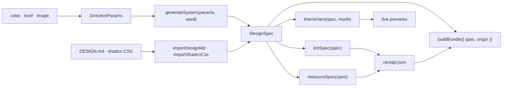

# 🎨 `dyelot`

> 🧾 **A palette becomes a design system your coding agent can build.**
> M0 to M5 are done: the shell, a tested color engine and spec model, the studio, the export bundle with its receipt, checker and import, the AI layer, and motion and 3D: a hero shader, a scroll story, a 3D explorer, a motion lab, two view transitions and the Flavor dialog. The gallery and the launch come next.

📖 [Why](WHY.md) · 📐 [Design spec](docs/specs/00-design.md) · 🧮 [Engine spec](docs/specs/01-color-engine.md) · 🎛️ [Studio spec](docs/specs/02-studio.md) · 📦 [Export spec](docs/specs/03-export.md) · 🤖 [AI spec](docs/specs/04-ai.md) · 🎞️ [Motion and 3D spec](docs/specs/05-motion-3d.md) · 🏗️ [Architecture](docs/specs/00-design.md#3-architecture) · 🗺️ [Milestones](docs/specs/00-design.md#14-milestones)


---

```console
$ pnpm install
$ pnpm dev          # http://localhost:3000: the home page, and the studio at /studio
$ pnpm gate         # lint, typecheck, the fast unit tests, then the end-to-end run
$ pnpm gate:full    # the same with every unit test and the coverage floors
```

---

## 💡 Why this exists

A palette is a few swatches. A product needs roles, a light mode and a dark mode, and a measured
contrast for every pair of text and background. Palette tools stop at the swatches, the nearest theme
editor serves one framework, and the DESIGN.md catalogs copy real brands. dyelot aims to take a color,
a few words or an image to a complete system that a coding agent can build from. [WHY.md](WHY.md) has
the full reasoning.

---

## 🎯 What it will do

The goal comes from the [design spec](docs/specs/00-design.md). M1 built the engine underneath the second and fifth
bullets. M2 built the studio, which puts the second and third in front of a visitor. M3 built the fourth and fifth bullets
and the import of an existing DESIGN.md. M4 built the brief, the image drop and the refine-in-words steps of the first bullet,
with a rule-based path for each. M5 built the motion and 3D pieces and the flavor files of the fifth bullet. The next sections say what each does today.

- 🎨 **Start from anything** — a color, a few words, an image, a curated system or an existing DESIGN.md
- 🧮 **Computed, accessible systems** — color roles and scales for light and dark mode, plus type, space, shape, depth and motion, solved for WCAG 2.2 contrast
- 👀 **Live previews** — six realistic pages that share one state, at phone, tablet and desktop widths
- 📦 **Agent handoff** — one download with DESIGN.md, an AGENTS.md block, `theme.css`, DTCG tokens, a shadcn install file and a ready prompt
- 🧾 **A receipt for every color** — `receipt.json` records measured contrast, color-blind distinguishability and gamut membership
- 🎬 **Flavor** — a palette-driven animated background, a brand video rendered in the browser and motion tokens

---

## 📦 The export today (M3)

The studio's Export button (Mod+E) turns the design on screen into one zip of plain text files, and Import takes a DESIGN.md or
a shadcn theme in. The [export spec](docs/specs/03-export.md) has every rule and case.

- 📁 **The bundle** — 18 to 21 files in a fixed order, UTF-8 with LF line ends: `DESIGN.md`, `AGENTS.md.snippet`, `prompt.md`, a Tailwind v4 `app/theme.css`, a shadcn registry theme with one font item per family that `next/font/google` can load (0 to 3), four DTCG token files, two Figma token files, a TOON view, three motion files, an agent skill, the checker and `receipt.json` last. The zip is byte-for-byte the same on every run: the same bytes in every time zone the tests try
- 🧾 **The receipt** — `receipt.json` (`dyelot.check/1`) records the design's spec id, its 80 measured contrast pairs, 16 color-vision separations, gamut membership, the 46 role colors of each mode, every lint finding and the SHA-256 of every other file. Ratios are cut, never rounded up, so 4.49999 prints as 4.4999 and never reads as passing
- ✅ **The checker** — `node scripts/dyelot-check.mjs` runs in a Next.js app with no dependency beyond Node. It compares the theme with the receipt, measures the 78 required pairs again, finds a role defined a second time after the theme, and scans the source for raw colors and Tailwind palette classes. It exits 0 on `PASS`, 1 on findings and 2 on an error, and `--json` prints one object
- 🚧 **A blocked export** — a design that fails a required check never leaves the studio: the dialog lists the failing checks, disables Download and every Copy, and the Findings section offers "Rebuild from the parameters" for a design that came from a link or a file
- 📥 **Import** — a DESIGN.md or a shadcn theme CSS file of at most 256 KiB, pasted or chosen, lays its colors over a generated base. A DESIGN.md that dyelot wrote re-imports unchanged from its edit link. A value the importer cannot read is listed in its report and skipped
- 🏷️ **About** — a name and a one-line description, kept as plain text. The name shows in the export dialog's lot line and gives the zip its file name

The tests check the bundle against outside tools: the DTCG and shadcn JSON schemas, the pinned `@google/design.md` linter, Tailwind's own
`compile`, a TOON round trip and the checker on a fixture app.

### Hand smoke

The M3 hand smoke installed the `default` golden's bundle (LOT 4177·a34c) into a fresh Next.js app by each route, with node 24.19.0,
next 16.4.3, react 19.3.0, tailwindcss 4.3.4 and shadcn 4.23.0. The first run of Route 2 found a defect: the registry route
writes the palette scale into `globals.css`, and the checker counted those 176 lines as raw colors. The fix changed the checker and
the Install text, and the rerun on commit `5ee5bfe` used fresh apps. Both routes pass, and the checker as it ships after the
final review's fixes passes both apps too.

| Route | Commands | Result |
|---|---|---|
| 1, the stylesheet | `npx create-next-app@16.4.3 route1b --ts --tailwind --app --no-src-dir --eslint --import-alias "@/*" --use-npm --yes --disable-git`; copy `app/theme.css`, `scripts/dyelot-check.mjs` and `receipt.json`; `globals.css` keeps `@import "tailwindcss";` and adds `@import "./theme.css";`; `npm install @fontsource/young-serif @fontsource-variable/onest @fontsource/fragment-mono` and import each in `app/layout.tsx`; `npx next build`; `node scripts/dyelot-check.mjs` | Build succeeded. The checker exited 0: `92 roles · 78 pairs · 6 files scanned`, `PASS`. With `bg-blue-500` and `style={{color:"#ff0000"}}` added, it exited 1 with a `palette-class` and a `raw-color` finding, `FAIL (2 findings)`. With both removed, `PASS` again |
| 2, shadcn | `npx create-next-app@16.4.3 route2b` (same flags); `npx shadcn@4.23.0 init --defaults --yes`; copy `registry/`, `scripts/dyelot-check.mjs` and `receipt.json`, but not `app/theme.css`; `npx shadcn@4.23.0 add ./registry/default.json --yes`, then `add ./registry/font-young-serif.json`, `font-onest.json` and `font-fragment-mono.json`; `npx next build`; `node scripts/dyelot-check.mjs` | Build succeeded. The checker exited 0: `92 roles · 78 pairs · 8 files scanned`, `PASS`. With `bg-blue-500` added, it exited 1 with one `palette-class` finding, `FAIL (1 finding)`. With it removed, `PASS` again |

The smoke rendered nothing in a browser: it checked the build and the checker, not how the pages look.

---

## 🎛️ The studio today (M2)

`/studio` turns a few parameters into a design system and shows it live. It runs in the browser: generation runs in a
Web Worker, the design lives in the URL hash, and a draft stays in the visitor's own storage. The
[studio spec](docs/specs/02-studio.md) has every rule and case.

- 🎚️ **Inputs** — three seed colors with locks, harmony, chroma, neutral tint, contrast level, gamut, scale mode, 14 presets, 20 font pairings over 40 self-hosted font families, type context, radius, depth, density and motion feel
- 🖼️ **Canvas** — six templates on one shared spec: a landing page, a SaaS dashboard, settings and forms, three mobile screens, an editorial article and a kitchen sink. Frames of 360, 768 and 1280 px, light or dark mode, density, reduced motion, edge-case copy and three color-vision views
- 🔍 **Inspector** — the 8 scales with each step's contrast, the 46 roles in both modes with their WCAG ratio and the advisory perceptual score, color names, and the lint findings, each with "show me". C1, C5, N1 and F1 come with a fix
- 🧭 **Taste rules** — four warnings in the linter: a generic display face, the purple-on-white default, a Tailwind default hex and body text under 16 px
- 🔗 **Links and drafts** — a share link carries the whole design with an integrity check. A damaged, cut or future-version link opens the studio with a banner that names the reason
- ⌨️ **Keyboard** — Space regenerates, L locks the focused seed, ← and → undo and redo, Alt+T flips the mode and Mod+S copies the link

The canvas fonts are copied from Fontsource packages at build time, so no request goes to Google. Since M3 the inputs panel opens with an About section (a name, a one-line description and Import…), and the toolbar gains Export.

---

## 🧮 The engine (M1)

A pure TypeScript core in `src/engine/` and `src/spec/`, with no DOM, no network and no `Math.random`. The studio is
its first UI. The [engine spec](docs/specs/01-color-engine.md) has every rule and case.

- 🎨 **Color math** — parses hex, `rgb()` and `oklch()`, converts between OKLCH, sRGB and Display P3, and maps to a gamut with the CSS Color 4 method
- 📏 **Contrast-solved scales** — 11 steps per palette, each solved for a WCAG 2.2 contrast target and measured again on the 8-bit hex it emits, in light and dark mode
- 🧩 **A complete color system** — eight palettes, 46 roles per mode, chart colors picked to stay apart under three kinds of color blindness, and a locked brand color kept verbatim where contrast allows
- 🔤 **Non-color tokens** — type scales by context, space, radius, shadows and motion
- 🧾 **A spec with an identity** — the `dyelot.spec/1` schema, a canonical form, a 16-hex spec id and a share link with an integrity check that rejects any one-character change
- 🔍 **A linter** — 20 measured rules over contrast, color-blind distinguishability, scale order, chroma, gamut and dark mode, and since M2 the four taste rules

---

## 🤖 The AI layer today (M4)

The studio keeps working with zero model calls: every feature has a rule-based path that runs when no model answers, and every
model path is labeled. A model never writes a color value. The [AI spec](docs/specs/04-ai.md) has every ruling and case.

- 📝 **Brief** — a visitor types words and gets a design. A model reads them when one is available. Without one, a word list of at least 400 terms in six categories, with no brand or company name, sets the direction, and colors named in the brief (hex, `rgb()`, `hsl()` or `oklch()`) lock the seeds with no call at all
- 🎚️ **Steer chips** — warmer, cooler, bolder, quieter, softer, sharper and airier. Each chip changes the design with no model call, and a chip that would change nothing is disabled with its reason. A sentence in the refine box goes to a model through ten closed op kinds; an op outside them fails that tier
- 🖼️ **Image palette and vibe** — a dropped image is decoded and reduced to 256 px in a worker, and `colorthief` returns the clusters that become the seeds, with no call. "Read the vibe" sends a 768 px JPEG and the clusters to a model, which picks roles among the cluster ids and names a mood and a type vibe
- ✍️ **Rationale and critique** — on an explicit click, a model writes the one-liner, the thesis and the rules into the spec; without a model nothing is written and the export keeps the preset's text. The critique ranks and explains the lint findings, and is shown but never stored
- 🔀 **Three providers, in order** — Chrome's on-device model when the visitor turns it on (labeled experimental), then the visitor's own OpenRouter key through a PKCE sign-in (`:free` slugs only), then the shared route. If none answers, the rule-based path runs and the page says so
- 🛡️ **The shared route and its guard** — `POST /api/ai/<feature>` calls OpenRouter's free models with the server key, one tier at a time with 20 s per tier. Before a call it requires a matching `Origin`, reads `GET /key` and refuses below `DYELOT_AI_RESERVE + 3` requests, and it sets a soft cap of 3 actions per visitor in an HMAC-signed cookie. Results are cached per server instance for 24 hours. A `vercel.json` opts the route into request cancellation
- 🔒 **A nonce CSP** — every page carries a per-request nonce, with `connect-src 'self' https://openrouter.ai`, and model text is rendered as text only

### Live smoke

The live smoke sent one call per unique slug through dyelot's own request builder: 7 calls in all over two runs, the second
approved by the owner. `google/gemma-4-26b-a4b-it:free` answered with a valid reply (an image call).
`nvidia/nemotron-3.5-super-vl:free` failed the first run and answered validly on the second (11.3 s, an image call).
`xingchen-agi/xing4.0-29b-a4b:free` answered empty (no content, 11.4 s, a text call), and
`dots-studio/dots-3-note-preview:free` timed out (over the 20 s per-tier limit, an image call). No slug answered HTTP 400.
On Vercel Production the primary and vision-1 slugs are `gemma-4-26b` and the fast and vision-2 slugs are
`nemotron-3.5-super-vl`; the fallback and vision-3 slugs are unset. Preview deployments have none of the AI variables, so
previews use the rule-based paths.

The on-device eval was not run: no Chrome with the built-in model was available in the session. Its page,
`/dev/on-device-eval`, exists in development builds only, and the switch stays labeled "(experimental)".

---

## The motion and 3D layer today (M5)

Every moving piece has a still form that reduced motion gets, and every piece that needs WebGL2 or WebCodecs has a fallback with
a sentence. The [motion and 3D spec](docs/specs/05-motion-3d.md) has every ruling and case.

- **The hero shader** — `/` paints a shader from five solved steps of a design, mixed in OKLab, so every color it shows is a step of the design. Six hero designs, named after historical dyes (Madder, Weld, Verdigris, Woad, Logwood and Cochineal), are committed data that a unit test rebuilds with `generateSystem`, and "Next palette" cycles them. Without WebGL2, or after a lost context or a shader failure, a CSS background and a sentence take its place; under reduced motion it draws one still frame
- **The scroll story** — five steps in which one design assembles itself, driven by CSS scroll-driven animations. The last step is the receipt's count. Under reduced motion every step shows its final state
- **The 3D explorer** — `/explore` places the design's 88 steps (8 palettes of 11) as points, with 8 tubes, inside the sRGB, Display P3 and Rec. 2020 gamut solids, in one lazy chunk with one viewport. A flat SVG view with a lightness slice is always shown, labeled sliders give the keyboard the same control, and a browser without WebGL2 keeps the flat view with a sentence
- **The motion lab** — `/motion` edits the design's seven durations, four easings and three springs, starts from one of five presets, previews them with the `motion` kit, exports the three motion files and opens the studio with the edited tokens. A design edited here carries them in the optional `motionTokens` parameter and gets a new spec id; every other design keeps its id
- **Two view transitions** — the studio's template switch cross-fades, and a step of the inspector's Scales expands in place into a token row with its Tailwind token, its class and a Copy button for the CSS variable. Reduced motion takes both to 0 s
- **The Flavor dialog** — a toolbar button after Export opens a preview of the shader and a preview of the brand video, a 1280 by 720 composition of 180 frames in a Remotion `<Player>` with one Pause button
- **Render the brand video** — in the browser, to MP4 (H.264) or WebM (VP8), muted, as a download. The button shows when the browser has WebCodecs, and a browser that cannot render says so
- **Record the shader loop** — 300 frames of the shader as a seamless loop, written to MP4 or WebM by Mediabunny, as a download. Reduced motion does not block it, because a visitor asks for it
- **Flavor files in the export** — the export dialog's "Include flavor files" switch, off by default, adds nine text files under `flavor/`, so the bundle holds 27 to 30 files: the shader as a vanilla module and a React component, its CSS fallback, a palette file, and the Remotion source with its own README. A video is not a zip entry, because a render sends a usage event and is not byte-reproducible across browsers

### Licenses for reusers

- **Remotion is not MIT.** It is source-available under its own license: free for individuals and for companies of up to 3 people, and companies of 4 or more people need a Remotion Company License. The terms are at [remotion.pro/license](https://remotion.pro/license). dyelot uses it as an individual's project with `licenseKey: "free-license"`. The exported `flavor/remotion/` source carries a "Built with Remotion" header, and its README says the same
- **Mediabunny is MPL-2.0**, used unmodified
- **The 2D simplex noise** in `src/flavor/flavor.mjs` is adapted from stegu/webgl-noise under the MIT license, with its notice kept in the file and in the export
- **dyelot's own code stays MIT**

### Privacy of the brand video

Rendering the brand video runs in the visitor's browser. Remotion sends one usage event per render to remotion.pro, with the
visitor's IP address and the site's origin, and never the video or the design. dyelot cannot turn it off. A note says so before
the first render of each page load, and Cancel on the note sends nothing. Recording the shader loop sends nothing. The content
security policy's `connect-src` names `https://www.remotion.pro` for this event and nothing else beyond OpenRouter.

### Measured on 2026-11-06

All of these come from the spec's probes, run on a production build under the nonce CSP in Playwright's Chromium 156, which draws
WebGL through SwiftShader. The two budgets are hang guards on software WebGL, not product requirements.

| Probe | Result |
|---|---|
| The explorer's chunk | three, React Three Fiber, drei's `OrbitControls` and the scene share one lazy chunk of 931,611 bytes. None of the 12 chunks the route fetched holds a remote-asset string, the probe made no request off localhost, and none of the heavy libraries appears in a chunk of `/` or `/studio` |
| A brand video render | 5,286 ms from click to download, with the renderer's lazy load, over three runs of 5,283 to 5,286 ms; about 475 KB of MP4. One usage `POST` per render, no `OPTIONS` request. The render flows' timeout is 3 times that, 15,858 ms |
| A shader loop recording | 20,036 ms at worst over three runs (20,036, 17,157 and 17,008 ms) with the real shader, giving a budget of 61,000 ms. An earlier probe with a stand-in shader took 4,693 ms and an MP4 of about 4.79 MB, and the real shader costs about four times as much per frame in SwiftShader |
| A view transition | One `startViewTransition` call per template switch, the group animation at 250 ms and the root at 0 ms; with reduced motion every animation is at 0 ms |
| The toolbar | 119 px tall in 3 rows at 360 by 740 with "Flavor" added, under a bound of 170 px |
| The hero designs | Generating six designs took 986 ms warm plus 298 ms for the engine's first call, which is why they are committed data |

The M5 spec lists 255 cases in its section 14 (163 `C-` cases and 92 `F-` cases). The gate numbers of the close are {{M5_GATE}}.
The hand check on dyelot.vercel.app, with one real render that sends one usage event, follows the merge, and its result goes into
the spec's close note.

---

## 🔧 Architecture

The planned layers and their rules are in the [design spec](docs/specs/00-design.md#3-architecture).
The shell, the pure core, the studio and the export exist today: `generateSystem`, `lintSpec`, `themeVars`, the live previews,
`measureSpec`, `buildBundle` and the importers in the diagram below, and the AI layer: the schemas, the word list and the
router in `src/ai/`, with its server and browser shells in `src/server/ai/` and `src/features/ai/`; and motion and 3D: the shipped
sources in `src/flavor/`, and the landing, the explorer, the lab and the Flavor dialog in `src/features/`.



---

## 🗂️ Project structure

```text
src/
├── app/                    routes (/, /studio, /explore and /motion), metadata files and the error boundaries
├── components/terminal/    the house shell: nav, window, prompt, status bar
├── engine/                 the pure core: generateSystem, the presets and the linter
│   ├── color/              parsing, conversion, gamut, contrast, scales, palettes, roles, charts, names
│   ├── fonts/              the 40-family catalog and the 20 pairings
│   ├── tokens/             type, space, shape, depth and motion
│   └── lint/               the 20 color rules and the 4 taste rules
├── spec/                   the dyelot.spec/1 schema, canonical form, spec id and share-link codec
├── ai/                     the pure AI core: schemas, prompts, the word list, the request builder and the cascade plan
├── flavor/                 the shipped sources: the shader module, its React wrapper and the Remotion composition, which the export carries byte for byte
├── export/                 buildBundle and one writer per file, the receipt, the zip and the checker's source
│   └── checker/            dyelot-check.mjs, the zero-dependency script that the bundle carries
├── import/                 importDesignMd and importShadcnCss, loaded only through import()
├── theme/                  themeVars: a spec as CSS custom properties for the canvas
├── features/
│   ├── studio/             the studio: store, worker, links, drafts, inputs, toolbar and inspector
│   ├── preview/            the canvas, the preview kit and the six templates
│   ├── ai/                 the browser shell of the AI layer: the router, the providers and the steer chips
│   ├── landing/            the hero, the scroll story and the six hero designs
│   ├── explore/            the 3D explorer and its flat view
│   ├── motion/             the motion lab
│   ├── flavor/             the Flavor dialog: previews, the brand video render and the loop recording
│   ├── export/             the export dialog: file list, preview, copy and download
│   ├── import/             the import dialog: the form, the file picker and the notices
│   └── fonts/              the FontFace loader for the canvas fonts
└── lib/
    ├── site/               the validated site config and the metadata modules
    └── links.ts            the repository address
tests/
├── unit/                   Vitest: plain Node for the pure core, jsdom for the rest
├── golden/export/          the 15 golden bundles' manifest and the default bundle's files
└── e2e/                    Playwright on Chromium, with axe
docs/specs/
├── 00-design.md            the design spec (the umbrella)
├── 01-color-engine.md      the M1 spec: the engine, the spec model and the linter
├── 02-studio.md            the M2 spec: the studio, its templates and its gates
├── 03-export.md            the M3 spec: the bundle, the receipt, the checker and import
├── 04-ai.md                the M4 spec: the AI layer, the shared route and its guard
└── 05-motion-3d.md         the M5 spec: the shader, the explorer, the lab, transitions and flavor
scripts/
├── copy-fonts.mjs          copies the canvas fonts into public/fonts/ before dev and build
└── render-icons.mjs        renders the raster icons from src/app/icon.svg
```

---

## 🚀 Usage

You need pnpm 10 and a Node version that jsdom 30 supports: 22.22.2 or later on 22, 24.15.0 or
later on 24, or 26 and up. CI runs Node 24.

```bash
pnpm install
pnpm dev          # http://localhost:3000
```

`pnpm dev` serves on port 3000. The end-to-end run builds the app and serves that build on port 3100
(set `PORT` to change it), so a dev server and a test run can share a machine.

| Command | What it does |
|---|---|
| `pnpm dev` | Dev server on port 3000 |
| `pnpm build` · `pnpm start` | Production build, then the production server on port 3000 |
| `pnpm lint` · `pnpm format` | Biome check, and Biome check with fixes applied |
| `pnpm typecheck` | `next typegen && tsc --noEmit` |
| `pnpm test` · `pnpm test:watch` | Vitest once, and in watch mode |
| `pnpm test:fast` | The unit tests outside the slow set: the Vitest projects `core` and `web` |
| `pnpm vitest run --coverage` | Every unit test with the coverage floors enforced |
| `pnpm test:e2e` | Builds, serves on port 3100 and runs Playwright on Chromium |
| `pnpm gate` | Lint, typecheck, `pnpm test:fast`, then `pnpm test:e2e`: the gate of each task |
| `pnpm gate:full` | Lint, typecheck, every unit test with coverage, then `pnpm test:e2e`: the gate that closes a milestone. CI runs the same steps |
| `node scripts/render-icons.mjs` | Renders `favicon.ico`, `apple-icon.png` and the three manifest PNGs from `src/app/icon.svg` with Playwright's Chromium |

Run `pnpm exec playwright install chromium` once before the end-to-end tests or the icon script. Pass a
directory to the icon script to write the files there instead of in place.

`.env.example` documents `NEXT_PUBLIC_SITE_URL`. The app runs without it.

---

## 🧱 Stack

| Concern | Choice |
|---|---|
| App | Next.js 16.4 App Router, React 19.3, TypeScript strict |
| Motion and 3D | three 0.186.1, `@react-three/fiber` 9.8.2 and `@react-three/drei` 10.7.9 (for `OrbitControls` only) in one lazy chunk; `motion` 14.3.0; `remotion`, `@remotion/player` and `@remotion/web-renderer` 4.0.539; `mediabunny` 1.62.0; no `postprocessing` and no GSAP |
| Style | Tailwind 4.3, the portfolio's dark terminal tokens, Geist and Geist Mono, one madder accent |
| Color | OKLCH and WCAG 2.2 contrast, in a pure TypeScript engine |
| Spec | zod 4 in jitless mode (no `eval` under the CSP), fflate for the share link and the zip |
| Export and import | `@toon-format/toon` for the TOON view, `yaml` for DESIGN.md, `@csstools/css-color-parser` for imported colors |
| Quality | Biome, Vitest with jsdom, fast-check, Playwright with axe; dev-only `@google/design.md` (the DESIGN.md linter) and ajv (the JSON schemas) |
| Tooling | pnpm 10, Node `^22.22.2 \|\| ^24.15.0 \|\| >=26` (CI runs 24) |
| CI | GitHub Actions: lint, typecheck, unit tests with coverage and the build, then Playwright on Chromium |

---

## 🧪 Testing

| Metric | Value |
|---|---|
| Unit | {{M5_GATE}} Vitest tests in {{M5_GATE}} files, in `tests/unit/`, with {{M5_GATE}} skipped (one is an exhaustive sweep of all 16,777,216 8-bit seeds that runs only with `DYELOT_EXHAUSTIVE=1`). The pure core and the export and import layers run in plain Node, the rest in jsdom with Testing Library |
| Slow set | 37 of those files, listed in `vitest.config.ts` by their measured time alone: the property and scan tests that took 10 s or more. 25 run in the two slow projects and 12 in the `scan` project. `pnpm gate` leaves them to `pnpm gate:full` and CI |
| Spec cases | Every case in [`01-color-engine.md`](docs/specs/01-color-engine.md), [`02-studio.md`](docs/specs/02-studio.md) [`03-export.md`](docs/specs/03-export.md) and [`04-ai.md`](docs/specs/04-ai.md) has a test that carries its id, such as `C-SCALE-02` or `F-TPL-40`: 344 of 344 at the M1 close, 467 of 467 at the M2 close (322 unit cases and 145 flows), 338 of 338 in the M3 spec's section 10 (287 unit cases and 51 flows), and 224 of 224 in the M4 spec's section 14 (165 `C-` cases and 59 `F-` cases, checked by C-GUARD4-11). The M5 spec's section 14 lists 255 cases (163 `C-` cases and 92 `F-` cases) for the same rule |
| Goldens | 15 golden bundles (the 14 presets and the import of `shadcn-neutral.css`), pinned by `tests/golden/export/manifest.json` with each file's path, byte length and SHA-256. The `default` bundle holds 21 files and 409,581 bytes |
| The generated-design grid | Before any export code existed, a test grid measured 3,808 designs from five fixed grids against the required checks: none threw and none raised a lint error. Its ten test files took 434.9 s in total when each ran alone on a 16-core machine |
| Property tests | fast-check over arbitrary color strings, every parameter, random seeds, share-link tampering and the studio store's actions |
| End to end | {{M5_GATE}} Playwright flows on Chromium against `next build` and `next start`, on `/`, `/studio` and the 404 page, with axe on each route, on the export and import dialogs and on the inspector's Receipt section, and checks on the security headers |
| Measured findings | The fix scan generates 576 designs (288 in sRGB and 288 in Display P3) and finds no C1, C5, N1 or F1 finding at AA. The preset sweep fits all 14 presets into the landing, editorial, dashboard and settings templates at 360 and 768 px and into the three mobile screens: 252 views, none with an overflow or a broken word |
| Coverage scope | `src/engine/`, `src/spec/`, `src/theme/`, `src/export/`, `src/import/`, `src/lib/site/`, the canvas font loader and the 23 pure helper files of the studio, the preview, the export dialog and the import dialog. The end-to-end tier covers the components and routes |
| Coverage floors | 80% lines and statements, 75% functions and 70% branches over that scope. `src/engine/`, `src/spec/`, `src/theme/`, the font loader and each pure helper hold 95% lines, statements and functions and 90% branches. `src/export/` and `src/import/` hold 90% and 85% |
| Coverage at the M2 close | 99.64% statements, 98.65% branches, 100% functions and 99.68% lines over that scope |
| Coverage at the M3 close | 98.57% statements, 95.8% branches, 99.69% functions and 98.76% lines over the larger scope, measured on a 16-core machine |
| Coverage at the M4 close | 98.88% statements, 96.65% branches, 99.58% functions and 99.08% lines, from `pnpm gate:full` on `m4-ai` at `f37215a` |
| Coverage at the M5 close | {{M5_GATE}} |
| Gate times | At the M2 close `pnpm gate` took 172.8 s and `pnpm gate:full` took 601.3 s on the 8-core reference machine. At the M3 close, on a 16-core machine, `pnpm gate` took 262.8 s (4 min 22.8 s; 122 unit files, 2,516 tests passed and 1 skipped, 286 flows) and `pnpm gate:full` took 22 min 40 s (159 unit files, 286 flows). At the M4 close `pnpm gate` took 6 min 27 s (179 unit files, 4,517 tests passed and 3 skipped, 377 flows) and `pnpm gate:full` took 27 min 30 s (218 unit files, 4,713 tests passed and 3 skipped, 377 flows), on a 16-core desktop that was also running the owner's own applications. At the M5 close: {{M5_GATE}} |
| Not done in M3 | The templates still load eagerly (M2 final review M-12), and the settings template's top and save bars keep `overflow: hidden` without the clip margin. Both wait for M6 |
| Not done in M4 | The on-device eval did not run. Three residuals are accepted: a canceled action does not count against a visitor's soft cap (the reserve floor of 37 holds); a "don't" rule that starts with "Avoid" plus a gerund exports as "Don't <gerund>..."; and F-IMP-RF4, M3's 2 s import budget, fails on the measuring machine under heavy desktop load for M3 and M4 alike, with no time added by M4 in interleaved pairs. Section 18 of the M4 spec lists what is deferred |
| Static checks | Biome, and `tsc` in strict mode |

```bash
pnpm test:fast                   # unit, without the slow set
pnpm vitest run --coverage       # every unit test, with the floors
pnpm test:e2e                    # builds, serves and drives Chromium
```

---

## 🏛️ Engineering philosophy

| Principle | How it shows up |
|---|---|
| 🔴 **Spec-TDD** | Each milestone spec, such as `docs/specs/03-export.md`, lists every case, pass and failure, before the code. Every spec case has a test that carries its id. Tests come first. |
| 🚫 **Negative-space programming** | Public functions check their input, and the spec's failure cases test the checks. A wrong type throws `TypeError` and a value outside its domain `RangeError`. Color parsing, scale solving and link decoding have their own error types. A property over random parameters finds no NaN or Infinity in a generated spec. One internal kernel, the 3 by 3 matrix product, checks nothing. Its callers check first, and its comment says so. |
| 🔒 **Typed everything** | TypeScript strict with no `any`. A `Hex` is a branded string. In the core only `toHex` and the schema make one, and a guard test fails on any other cast. The schema is where a decoded link becomes a typed spec. |
| 🧊 **Pure core, imperative shell** | `src/engine/` and `src/spec/` use no DOM, no Node API, no `Date` and no `Math.random`. A grep test enforces it, and their tests run in plain Node, where a DOM call fails. Randomness comes only from a seeded generator. The same seed gives the same spec on every run in Node, and a golden spec id pins it. Browsers are not measured yet: the engine uses `Math.cbrt`, `Math.exp` and other functions whose last bits ECMAScript leaves to each engine. |
| 🧾 **Measure what ships** | Contrast is measured on the 8-bit hex the engine emits, never rounded, so a ratio of 4.499 fails 4.5. |
| 📦 **One responsibility per module** | Parsing, conversion, gamut, contrast, scales, palettes, roles, charts, tokens, the schema, the canonical form, the hash and the link codec each have their own file. |

---

## 🚫 Scope

Version 1 has no accounts, no server-side storage of designs, no paid tier, no brand-clone presets and
no server-side video rendering. Section 15 of the [design spec](docs/specs/00-design.md) lists the
rest.

---

## 🚧 Status

- **M0, done.** The repo in the house skeleton: Next 16.4, Biome, Vitest, Playwright, CI, site
  metadata, security headers, the terminal shell and the design spec.
- **M1, done.** The color engine, the spec model and the linter, in `src/engine/` and `src/spec/`,
  built to the [engine spec](docs/specs/01-color-engine.md).
- **M2, done.** The studio at `/studio`: the inputs, a live canvas with six templates, the inspector,
  share links and drafts, built to the [studio spec](docs/specs/02-studio.md).
- **M3, done.** The export bundle, the receipt, the checker and import, with their studio UI, built to the
  [export spec](docs/specs/03-export.md). The hand smoke installed the bundle into fresh Next.js apps by both routes, and
  the checker printed `PASS` in each.
- **M4, done.** The AI layer, built to the [AI spec](docs/specs/04-ai.md): the brief, the word list, the steer chips, image
  palettes and the vibe, the rationale and the critique, three providers, the shared route and its guard, and the nonce CSP.
  `pnpm gate:full` passed with 4,713 unit tests and 377 of 377 flows, and the live smoke found two of four slugs valid.
- **M5, done.** Motion and 3D, built to the [motion and 3D spec](docs/specs/05-motion-3d.md): the hero shader and the scroll story, the explorer, the motion lab, two view transitions, and the Flavor dialog with its previews, in-browser render and loop recording, and the flavor files. `pnpm gate:full` passed with {{M5_GATE}}. The hand check on the deployed site, with one real render, follows the merge.
- **Next.** M6 the gallery and the launch. The milestone table in the spec
  has the details.

`main` deploys to [dyelot.vercel.app](https://dyelot.vercel.app).

---

## 📜 License

MIT — see [LICENSE](LICENSE). Geist Mono is vendored under the SIL Open Font License
(`src/lib/site/fonts/OFL.txt`), and the nav glyph is lucide's swatch-book (ISC). The 40 canvas font families are
copied from their Fontsource packages under the SIL Open Font License, each with its license text. Remotion and Mediabunny carry
the terms in [Licenses for reusers](#licenses-for-reusers), and the shader's noise carries stegu/webgl-noise's MIT notice.

### Credits

The 3D explorer takes its idea from oklch-picker (MIT, Evil Martians). No code was taken from it: the gamut mesh is dyelot's own.

---

> 🎨 *A dye lot is a batch dyed together so every piece matches.*
