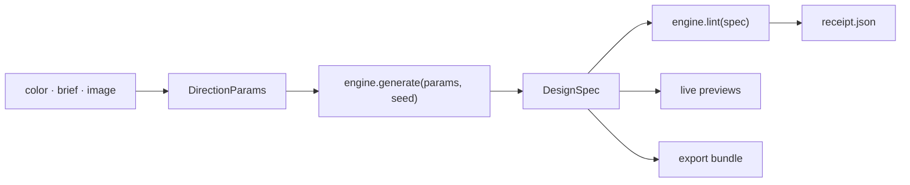

# 🎨 `dyelot`

> 🧾 **A palette becomes a design system your coding agent can build.**
> M0 is done and M1, the color engine, is in progress. The studio and the export bundle come next.

📖 [Why](WHY.md) · 📐 [Design spec](docs/specs/00-design.md) · 🏗️ [Architecture](docs/specs/00-design.md#3-architecture) · 🗺️ [Milestones](docs/specs/00-design.md#14-milestones)


---

```console
$ pnpm install
$ pnpm dev                                    # http://localhost:3000: the shell and a status page
$ pnpm lint && pnpm typecheck && pnpm test    # the quick gates
$ pnpm test:e2e                               # builds, serves on port 3100, drives Chromium
```

---

## 💡 Why this exists

A palette is a few swatches. A product needs roles, a light mode and a dark mode, and a measured
contrast for every pair of text and background. Palette tools stop at the swatches, the nearest theme
editor serves one framework, and the DESIGN.md catalogs copy real brands. dyelot aims to take a color,
a few words or an image to a complete system that a coding agent can build from. [WHY.md](WHY.md) has
the full reasoning.

---

## 🎯 What it will do

None of this ships yet. The goal comes from the [design spec](docs/specs/00-design.md).

- 🎨 **Start from anything** — a color, a few words, an image, a curated system or an existing DESIGN.md
- 🧮 **Computed, accessible systems** — color roles and scales for light and dark mode, plus type, space, shape, depth and motion, solved for WCAG 2.2 contrast
- 👀 **Live previews** — six realistic pages that share one state, at phone, tablet and desktop widths
- 📦 **Agent handoff** — one download with DESIGN.md, an AGENTS.md block, `theme.css`, DTCG tokens, a shadcn install file and a ready prompt
- 🧾 **A receipt for every color** — `receipt.json` records measured contrast, color-blind distinguishability and gamut membership
- 🎬 **Flavor** — a palette-driven animated background, a brand video rendered in the browser and motion tokens

---

## 🔧 Architecture

The planned layers and their rules are in the [design spec](docs/specs/00-design.md#3-architecture).
Only the shell exists today.



---

## 🗂️ Project structure

```text
src/
├── app/                    routes, metadata files and the error boundaries
├── components/terminal/    the house shell: nav, window, prompt, status bar
└── lib/
    ├── site/               the validated site config and the metadata modules
    └── links.ts            the repository address
tests/
├── unit/                   Vitest
└── e2e/                    Playwright
docs/specs/00-design.md     the design spec
scripts/render-icons.mjs    renders the raster icons from src/app/icon.svg
```

`src/engine/` and `src/spec/` arrive with M1.

---

## 🚀 Usage

You need Node 24 and pnpm 10.

```bash
pnpm install
pnpm dev          # http://localhost:3000
```

`pnpm dev` serves on port 3000. The end-to-end run builds the app and serves that build on port 3100
(set `PORT` to change it), so a dev server and a test run can share a machine.

| Command | What it does |
|---|---|
| `pnpm dev` | Dev server on port 3000 |
| `pnpm build` · `pnpm start` | Production build, then the production server on port 3000 |
| `pnpm lint` · `pnpm format` | Biome check, and Biome check with fixes applied |
| `pnpm typecheck` | `next typegen && tsc --noEmit` |
| `pnpm test` · `pnpm test:watch` | Vitest once, and in watch mode |
| `pnpm vitest run --coverage` | Unit tests with the coverage floors enforced |
| `pnpm test:e2e` | Builds, serves on port 3100 and runs Playwright on Chromium |
| `node scripts/render-icons.mjs` | Renders `favicon.ico`, `apple-icon.png` and the three manifest PNGs from `src/app/icon.svg` with Playwright's Chromium |

Run `pnpm exec playwright install chromium` once before the end-to-end tests or the icon script. Pass a
directory to the icon script to write the files there instead of in place.

`.env.example` documents `NEXT_PUBLIC_SITE_URL`. The app runs without it.

---

## 🧱 Stack

| Concern | Choice |
|---|---|
| App | Next.js 16.4 App Router, React 19.3, TypeScript strict |
| Style | Tailwind 4.3, the portfolio's dark terminal tokens, Geist and Geist Mono, one madder accent |
| Color | OKLCH and WCAG 2.2 contrast, in a pure TypeScript engine (M1) |
| Quality | Biome, Vitest with jsdom, fast-check, Playwright with axe |
| Tooling | pnpm 10, Node 24 |
| CI | GitHub Actions: lint, typecheck, unit tests with coverage and the build, then Playwright on Chromium |

---

## 🧪 Testing

| Metric | Value |
|---|---|
| Unit | Vitest with jsdom and Testing Library, in `tests/unit/`; property tests with fast-check start with the engine |
| End to end | Playwright on Chromium against `next build` and `next start`, with axe accessibility checks on the home and 404 pages and checks on the security headers |
| Coverage floors | 80% lines and statements, 75% functions and 70% branches; the engine and spec folders get 95% and 90% floors with M1 |
| Static checks | Biome, and `tsc` in strict mode |

```bash
pnpm test                        # unit
pnpm vitest run --coverage       # unit, with the floors
pnpm test:e2e                    # builds, serves and drives Chromium
```

---

## 🚫 Scope

Version 1 has no accounts, no server-side storage of designs, no paid tier, no brand-clone presets and
no server-side video rendering. Section 15 of the [design spec](docs/specs/00-design.md) lists the
rest.

---

## 🚧 Status

- **M0, done.** The repo in the house skeleton: Next 16.4, Biome, Vitest, Playwright, CI, site
  metadata, security headers, the terminal shell and the design spec.
- **M1, in progress.** The color engine, the spec model and the linter, in `src/engine/` and
  `src/spec/`.
- **Next.** M2 the studio and its six preview pages, M3 the export bundle, M4 the AI layers, M5 motion
  and 3D, M6 the gallery and the launch. The milestone table in the spec has the details.

There is no live deployment yet.

---

## 📜 License

MIT — see [LICENSE](LICENSE). Geist Mono is vendored under the SIL Open Font License
(`src/lib/site/fonts/OFL.txt`), and the nav glyph is lucide's swatch-book (ISC).

---

> 🎨 *A dye lot is a batch dyed together so every piece matches.*
